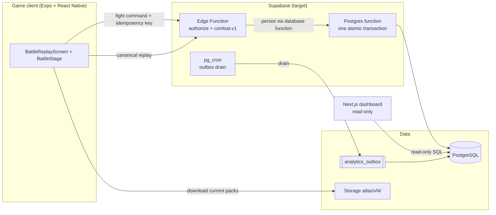

# Architecture overview

Implementer technical map for the TypeScript-first auto-battler. Server
authoritative; deterministic combat; replay-centric.

Product vision lives in ClickUp
([Overall Product Vision](https://app.clickup.com/90122060531/docs/2kxv30qk-1092/2kxv30qk-1852)).
This file is **not** the product source of truth. It is not a claim that Edge
Functions, database-function persistence, or modular media packs have already
shipped.

**Agreed target stack (7 November 2026):** fights run in a **Supabase Edge
Function** (`combat-v1` in-process). Persistence is a **Postgres database
function** in one atomic transaction. The analytics **outbox drains on
pg_cron**. Versioned media lives in Supabase Storage under **`atlas/vN/`**.
Do not extend leftover Fastify `apps/api` / `apps/worker`.

## Target stack

| Layer         | Decision                                                                                  |
| ------------- | ----------------------------------------------------------------------------------------- |
| Client        | Expo / React Native (iOS/Android). Web export is preview only.                            |
| Renderer      | Animated initially; Skia only if a measured release build fails agreed limits (ADR-0001). |
| Monorepo      | pnpm workspaces + Turborepo                                                               |
| Fight compute | Supabase Edge Function + `@botore/combat-engine` (`combat-v1`)                            |
| Persistence   | Postgres database function: one atomic transaction                                        |
| Outbox        | `pg_cron` (not a Fastify worker)                                                          |
| Media         | Supabase Storage `atlas/vN/` (PNGs, masks, geometry, separate audio)                      |
| Contracts     | TypeBox + OpenAPI (ADR-0003). Not an open TypeBox/Zod choice.                             |
| Auth / DB     | Supabase Auth + PostgreSQL. Client never writes gameplay tables via PostgREST.            |
| Dashboard     | Next.js, read-only reporting credential                                                   |
| Analytics     | First-party typed events + `analytics_outbox`. No cloud analytics account for local dev.  |
| Local         | Supabase CLI. No mandatory Docker Compose application-service dependency.                 |
| CI            | GitHub Actions                                                                            |

CSPRNG for fight seeds lives in the Edge Function. Do not add new CSPRNG
sites. Leftover `apps/api/src/seeds.ts` is not the location to extend.

## Containers (target)



Conceptual labels only: this document does not invent an RPC signature,
function name, or migration.

## Battle sequence (target)

Simulation runs **in-process** in the Edge Function. Persistence is **one
Postgres transaction inside a database function**. Those are not separate
network requests sharing a long-lived `BEGIN`. Replay **rendering duration**
is distinct from server simulation time.

1. Client asks for eligible opponents (level/build-power band, freshness,
   anti-farming).
2. Player submits a fight command with an idempotency key.
3. Edge Function authorizes, confirms eligibility, snapshots immutable combat
   builds **including media/build version**, creates a CSPRNG seed, records
   `rulesVersion`. The client never supplies the seed or the winner.
4. `combat-engine` runs with integer/fixed-point math and the injected PRNG
   only.
5. Database function atomically: idempotency lookup; `SKIP LOCKED` consume one
   fight allowance; persist battle, participants, replay, progression ledger
   (+2 XP win / +1 XP loss), analytics outbox.
6. Client fetches and renders the canonical event stream. Defensive
   participation costs the defender nothing.

```mermaid
sequenceDiagram
    actor P as Player
    C as Client (Expo)
    EF as Edge Function
    E as combat-engine (pure)
    DB as Postgres function

    P->>C: select opponent, tap Fight
    C->>EF: fight command + idempotency key
    EF->>EF: authorize, eligibility, snapshot + media version, CSPRNG seed
    EF->>E: simulate(attackerSnapshot, defenderSnapshot, seed)
    E-->>EF: events[] + outcome + checksum
    EF->>DB: atomic persist: idempotency, SKIP LOCKED allowance,<br/>battles, replays, progression_ledger, outbox
    alt key already persisted
        DB-->>EF: original result (no side effects)
    else new key
        DB-->>EF: committed battleId + outcome
    end
    EF-->>C: result + replay locator
    C->>EF: fetch canonical replay if not already returned
    EF-->>C: canonical replay
    C->>P: render event stream via animation queue
```

Prove concurrency, failure, and retry on this boundary. Benchmarks validate
the Edge runtime; they do not reopen the stack decision.

## Replay envelope

Full semantic events are required (ADR-0005). A seed alone is insufficient.
Envelope fields (checksums and schema unchanged here):

```ts
interface BattleReplay {
  replayVersion: number;
  rulesVersion: string;
  battleId: string;
  seed: string;
  inputHash: string;
  fighters: readonly FighterSnapshot[];
  events: readonly BattleEvent[];
  outcome: BattleOutcome;
  checksum: string;
}
```

Saved fights also retain immutable **build/media version** references so
historical appearance and sound can be reconstructed. Do not silently change
checksum algorithms.

## Determinism (engine)

- No `Math.random()`, wall-clock, locale-sensitive sorting, or unordered
  object iteration in pure packages.
- Inject PRNG and logical clock. Pin algorithm and `rulesVersion`.
- Golden fixtures: known input + seed → event hash + outcome.
- Property tests: termination, HP bounds, event validity, identical repeats.
- Hard maximum action count and explicit draw resolution (`combat-v1`).

Formulas and draw order: `docs/architecture/combat-v1.md`.

## Atlas and loadout (implementer)

Storage prefix: **`atlas/vN/`** (example `atlas/v3/`). Manifest lists part
PNGs, paint masks, attachment geometry, and **separate** audio files. Sound is
not stored in image pixels. Client downloads packs for the stable and the
current fight only. Base pack is bundled; missing audio must not block the
fight. See `docs/audio/README.md`.

Client previews loadouts; a server function validates ownership and slot
compatibility and confirms persistence. Client code does not write loadout,
catalogue, inventory, progression, or reward tables. Failed saves keep the
last confirmed loadout. Stable, preview, and fight use the same assembly
rules.

## Target tree

Paths marked remnant exist from bootstrap; do not extend them.
`supabase/functions/` is planned, not shipped.

```text
apps/game/                 # Expo / React Native presentation
apps/api/                  # remnant — do not extend
apps/worker/               # remnant — do not extend
apps/dashboard/            # Next.js read-only
packages/combat-engine/    # pure combat-v1
packages/domain/
packages/contracts/        # TypeBox
packages/rng/
packages/replay/
packages/analytics-events/
supabase/functions/        # planned Edge Function entrypoints
supabase/migrations/
```

## Backend modules (cohesive, in-repo)

Identity/profile, roster/loadout, arena, simulation (Edge Function +
combat-v1), progression/ledgers, analytics ingestion (outbox), administration
(audit). Tournaments deferred. No microservices split (ADR-0004). Redis is
out of scope until measurements demand it.

Gameplay commands terminate at the Edge Function. RLS is deny-by-default
defense in depth; the server credential is the only writer.

## Data model (slice)

Present: `accounts`, `profiles`, `devices`, `consents`, `characters`,
`character_build_versions`, `character_cosmetics`, `fight_allowances`
(3/UTC day), `opponent_impressions`, `battles`, `battle_participants`,
`battle_replays`, append-only `progression_ledger`, `inventory_ledger`,
`wallet_ledger`, `analytics_outbox`, `admin_audit_log`.

Target additions (model only — no schema in this pass): server-validated
loadout, catalogue parts, immutable build/media versions on saved fights.

Scarce currency and progression use append-only ledgers; materialized
balances must be reconstructable. Later: `tournaments`, `guilds` (not now).

## Analytics events (implementer)

Shared schema; **server** is authoritative for economy and battle outcomes.
Each event: `event_id`, `event_name`, `schema_version`, `occurred_at`;
consent-permitted identifiers; app/build/platform context; battle/rules ids
when relevant; privacy classification and `client` | `server` source. Do not
put replay payloads, free text, secrets, or auth tokens in analytics. Outbox
rows are written in the fight transaction and drained by **pg_cron**.

## Security (implementer)

- Edge Function creates seeds and identifies canonical replays.
- Client cannot submit winners, damage, XP, rewards, or loadout authority.
- Idempotency keys + unique constraints on reward-bearing commands.
- Snapshot combat inputs and hashes.
- Secrets in env/secret managers, never game bundles.
- Validate Edge Function, contract, and analytics payloads at runtime.
- Rate-limit with privacy review. Audit admin/economy grants.
- A demonstrably unsafe code path is enough to block; exploitation is not
  required.

## Tests and CI

Unit (domain, PRNG, combat, progression); golden fixtures; property tests;
TypeBox contract tests; DB/RLS/idempotency tests; Edge Function + local
Supabase integration (leftover Fastify tests describe remnants until
replaced); Expo replay smoke; dashboard read-only; E2E account → bot →
candidate → fight → replay → reward.

CI: format, lint, types, unit/property, migrations, integration, dashboard
build, license inventory, boundary check, secret scan. Native evidence is
required for integrated fight acceptance; a web build is not enough.

## Layering rules

- `packages/{rng,domain,replay,combat-engine}` are pure: no IO, no clocks,
  no `Math.random()`, no framework imports (including React Native and
  Supabase SDKs). Enforced by `scripts/check-boundaries.mjs`.
- Dashboard uses its own reporting pool; service-role keys never reach the
  browser.
- Portability of the **deployment** (Edge Functions, database functions,
  Auth, Storage `atlas/vN/`, pg_cron): ADR-0007 (amended). Pure packages
  remain portable.
