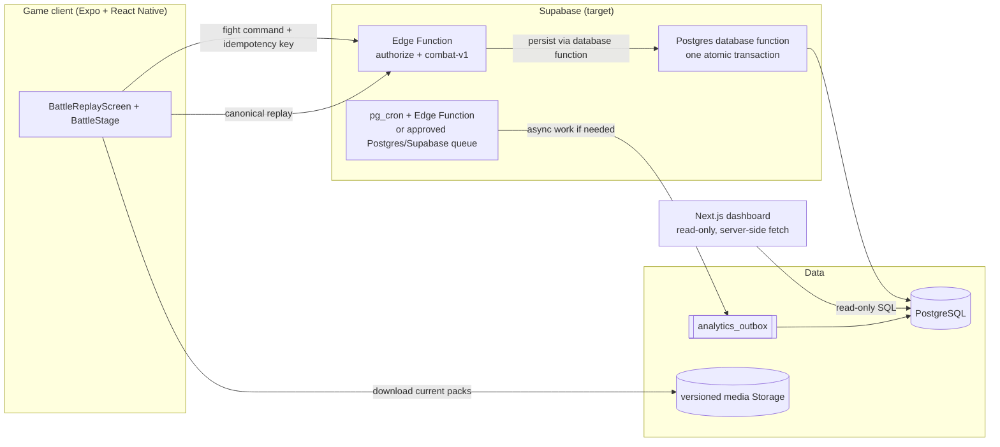

# Architecture overview

TypeScript-first monorepo for an asynchronous auto-battler. Server
authoritative; deterministic combat; replay-centric.

This file describes the **target** plan aligned with the 7 November 2026
decisions (see `game-architecture-report.md`). It is not a claim that Edge
Functions, database-function persistence, or modular media packs have already
shipped.

**Implemented today (bootstrap remnant):** leftover Fastify `apps/api` and
`apps/worker` still serve the vertical-slice HTTP path (`POST /v1/battles`,
`GET /v1/battles/:id/replay`) and CSPRNG still lives in
`apps/api/src/seeds.ts`. Do not extend that surface. Target CSPRNG is the
server-side fight resolver (Supabase Edge Function using `combat-v1`).

## Containers (target)



Conceptual labels only: this document does not invent an RPC signature,
function name, or migration.

## Battle sequence (target)

Simulation runs **in-process** in the Edge Function. Persistence is **one
Postgres transaction inside a database function**. Those are not separate
network requests sharing a long-lived `BEGIN`.

```mermaid
sequenceDiagram
    actor P as Player
    C as Client (Expo)
    EF as Edge Function (resolver)
    E as combat-engine (pure)
    DB as PostgreSQL database function

    P->>C: select opponent, tap Fight
    C->>EF: fight command + idempotency key
    EF->>EF: authorize, eligibility, snapshot builds, CSPRNG seed
    EF->>E: simulate(attackerSnapshot, defenderSnapshot, seed)
    E-->>EF: events[] + outcome + checksum
    EF->>DB: atomic persist: idempotency, SKIP LOCKED allowance,<br/>battles, replays, progression_ledger (+2 win / +1 loss), outbox
    alt key already persisted
        DB-->>EF: original result (no side effects)
    else new key
        DB-->>EF: committed battleId + outcome
    end
    EF-->>C: result + replay locator
    C->>EF: fetch canonical replay if not already returned
    EF-->>C: canonical replay
    C->>P: render event stream via animation queue
```

Invariants retained: server authority, deterministic `combat-v1` events, server
CSPRNG seed, immutable input snapshots, full semantic event storage (a seed
alone is insufficient), and a single atomic Postgres transaction for allowance
consumption plus outcome/reward/outbox persistence.

## Layering rules

- `packages/{rng,domain,replay,combat-engine}` are pure: no IO, no clocks,
  no `Math.random()`, no framework imports (including React Native and
  Supabase SDKs). Enforced by `scripts/check-boundaries.mjs` in CI.
- Target CSPRNG boundary: the Edge Function fight resolver. Do not add new
  CSPRNG call sites. Leftover `apps/api/src/seeds.ts` (`node:crypto`) is not
  the location to extend.
- The client renders replays; it never computes outcomes or writes loadout,
  catalogue, inventory, progression, or reward tables.
- The dashboard reads through its own server-side pool with a reporting
  credential; service-role keys never reach the browser.

## Data model (slice)

`accounts → characters (+ immutable build versions) → battles → participants`
plus `fight_allowances` (3/UTC day), `battle_replays`, append-only
`progression_ledger`, `analytics_outbox`, `admin_audit_log`. RLS is enabled on
all gameplay tables with deny-by-default policies; the server credential
bypasses RLS by design and is the only writer.

Target additions (model only — no schema in this documentation pass):
server-validated loadout configuration, catalogue parts, and immutable
build/media version references on saved fights so historical appearance and
sound can be reconstructed. ADR-0005 checksums and replay envelope fields are
unchanged here.
